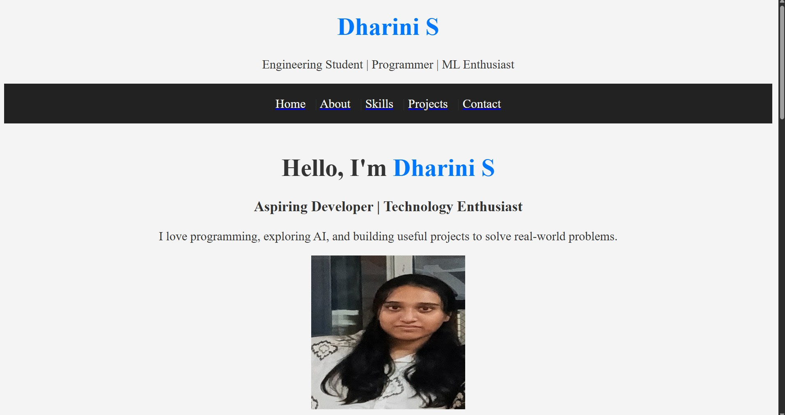
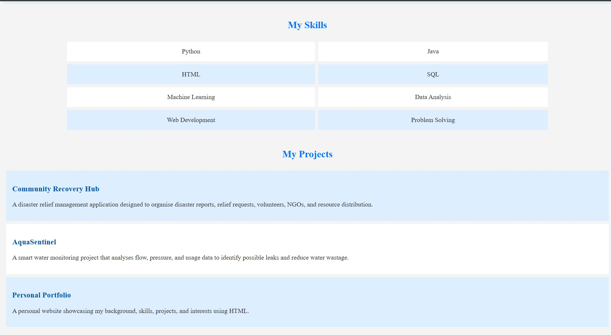
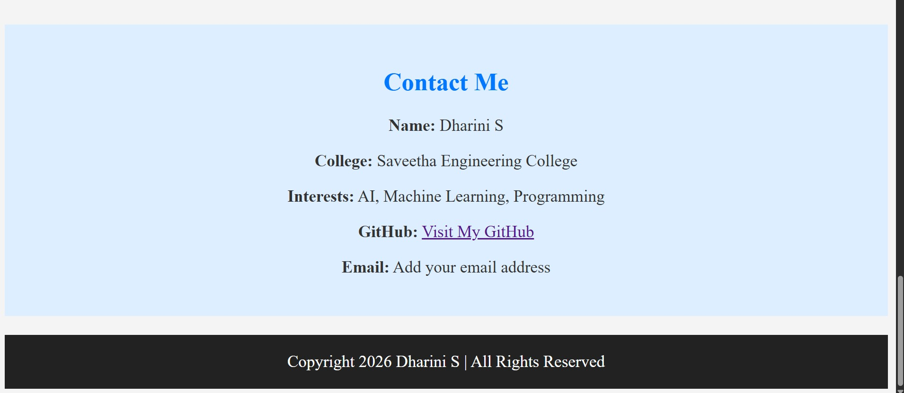

# Ex01 Portfolio
## Date:24-10-2026

## AIM
To create a Portfolio using HTML and CSS.

## ALGORITHM
### STEP 1
Create an HTML file (index.html)

### STEP 2
Create a CSS file (style.css)

### STEP 3
Include a navigation bar with links to different sections.

### STEP 4
Add structured sections for introduction, about, projects, and contact details.

### STEP 5
Define global styles for fonts, colors, and layout.

### STEP 6
Style the header, navigation bar, and sections.

### STEP 7
Use Flexbox or CSS Grid for layout design.

### STEP 8
Add hover effects and transitions for interactivity.

### STEP 9
Add Images and Media.

### STEP 10
Use optimized images for a professional look.

### STEP 11
Open the HTML file in a browser to check layout and functionality.

### STEP 12
Fix styling issues and refine content placement.

### STEP 13
Deploy the Portfolio.

### STEP 14
Upload to GitHub Pages for free hosting.

## PROGRAM
```

<!DOCTYPE html>
<html lang="en">
<head>
    <meta charset="UTF-8">
    <meta name="viewport" content="width=device-width, initial-scale=1.0">
    <title>Dharini S | Portfolio</title>
</head>

<body bgcolor="#f4f4f4" text="#333333">

    <center>
        <h1><font color="#0077ff">Dharini S</font></h1>
        <p>Engineering Student | Programmer | ML Enthusiast</p>
    </center>

    <table width="100%" bgcolor="#222222" cellpadding="15">
        <tr>
            <td align="center">
                <a href="#home"><font color="white">Home</font></a> &nbsp; |
                <a href="#about"><font color="white">About</font></a> &nbsp; |
                <a href="#skills"><font color="white">Skills</font></a> &nbsp; |
                <a href="#projects"><font color="white">Projects</font></a> &nbsp; |
                <a href="#contact"><font color="white">Contact</font></a>
            </td>
        </tr>
    </table>

    <br>

    <section id="home">
        <center>
            <h1>Hello, I'm <font color="#0077ff">Dharini S</font></h1>

            <h3>Aspiring Developer | Technology Enthusiast</h3>

            <p>
                I love programming, exploring AI, and building
                useful projects to solve real-world problems.
            </p>

            

            <br><br>

            <a href="#contact">Contact Me</a>
        </center>
    </section>

    <br>

    <table width="100%" bgcolor="#dceeff" cellpadding="20">
        <tr>
            <td>
                <section id="about">
                    <center>
                        <h2><font color="#0077ff">About Me</font></h2>
                    </center>

                    <p>
                        I am an engineering student at Saveetha
                        Engineering College with an interest in
                        programming, web development, artificial
                        intelligence, and machine learning. I enjoy
                        building practical projects, analysing data,
                        and exploring new technologies. My goal is
                        to improve my technical skills and create
                        solutions that make a positive difference.
                    </p>
                </section>
            </td>
        </tr>
    </table>

    <br>

    <section id="skills">
        <center>
            <h2><font color="#0077ff">My Skills</font></h2>

            <table width="80%" cellpadding="15" cellspacing="8">
                <tr bgcolor="#ffffff">
                    <td align="center">Python</td>
                    <td align="center">Java</td>
                </tr>

                <tr bgcolor="#dceeff">
                    <td align="center">HTML</td>
                    <td align="center">SQL</td>
                </tr>

                <tr bgcolor="#ffffff">
                    <td align="center">Machine Learning</td>
                    <td align="center">Data Analysis</td>
                </tr>

                <tr bgcolor="#dceeff">
                    <td align="center">Web Development</td>
                    <td align="center">Problem Solving</td>
                </tr>
            </table>
        </center>
    </section>

    <br>

    <center>
        <h2><font color="#0077ff">My Projects</font></h2>
    </center>

    <section id="projects">

        <table width="100%" cellpadding="15" cellspacing="8">

            <tr>
                <td bgcolor="#dceeff">
                    <h3><font color="#0055aa">
                        Community Recovery Hub
                    </font></h3>

                    <p>
                        A disaster relief management application
                        designed to organise disaster reports,
                        relief requests, volunteers, NGOs, and
                        resource distribution.
                    </p>
                </td>
            </tr>

            <tr>
                <td bgcolor="#ffffff">
                    <h3><font color="#0055aa">AquaSentinel</font></h3>

                    <p>
                        A smart water monitoring project that
                        analyses flow, pressure, and usage data
                        to identify possible leaks and reduce
                        water wastage.
                    </p>
                </td>
            </tr>

            <tr>
                <td bgcolor="#dceeff">
                    <h3><font color="#0055aa">
                        Personal Portfolio
                    </font></h3>

                    <p>
                        A personal website showcasing my
                        background, skills, projects, and
                        interests using HTML.
                    </p>
                </td>
            </tr>

        </table>

    </section>

    <br>

    <table width="100%" bgcolor="#dceeff" cellpadding="20">
        <tr>
            <td>
                <section id="contact">
                    <center>
                        <h2><font color="#0077ff">Contact Me</font></h2>

                        <p><b>Name:</b> Dharini S</p>

                        <p>
                            <b>College:</b>
                            Saveetha Engineering College
                        </p>

                        <p>
                            <b>Interests:</b>
                            AI, Machine Learning, Programming
                        </p>

                        <p>
                            <b>GitHub:</b>
                            <a href="https://github.com/Dharini-maker">
                                Visit My GitHub
                            </a>
                        </p>

                        <p>
                            <b>Email:</b> Add your email address
                        </p>
                    </center>
                </section>
            </td>
        </tr>
    </table>

    <br>

    <table width="100%" bgcolor="#222222" cellpadding="15">
        <tr>
            <td align="center">
                <font color="white">
                    Copyright 2026 Dharini S | All Rights Reserved
                </font>
            </td>
        </tr>
    </table>

</body>
</html>
```

## OUTPUT





## RESULT
The program for creating Portfolio using HTML and CSS is executed successfully.
